# Screens and requirements

The plan for each screen in the [Figma file](https://www.figma.com/design/r6RysycQdSts0aWMk6jEsK), with what it needs before it counts as built. "Existing" endpoints are already in the backend. "New" ones still need to be added. The model art in the screenshots is a placeholder. The app renders the real mesh with Three.js.

## 1. Dashboard

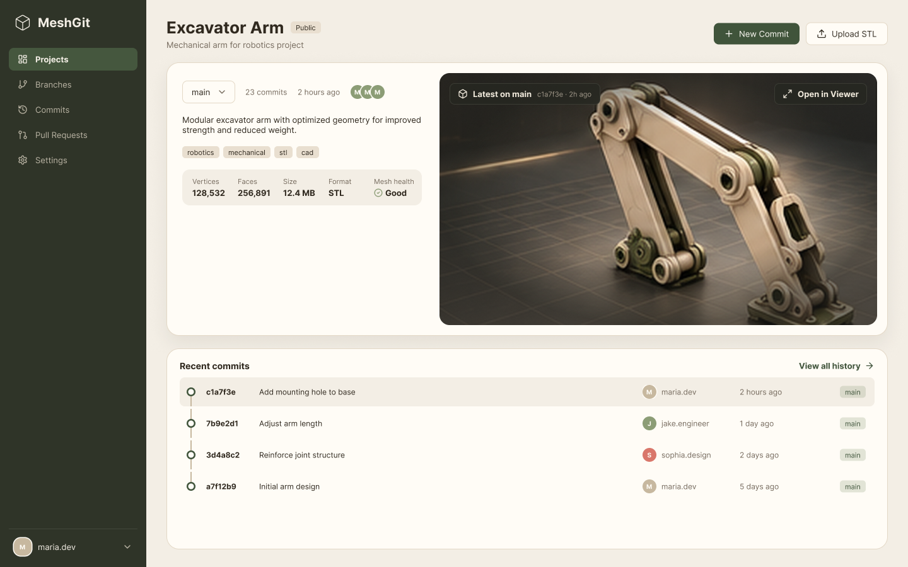

The default view for a project. The latest model on `main` takes most of the page, so you see the current state of the design first.

- Header with the project name, visibility, description, **New Commit**, **Upload STL**, and a menu.
- A card with the branch picker, commit count, last commit time, and contributors, plus the mesh metadata for the latest commit (vertices, faces, size, format, units, watertight check).
- The latest commit on the selected branch renders in a viewport with orbit, pan, zoom, and fit controls. **Open in Viewer** goes to screen 2.
- A right column with recent commits across all branches, newest first. Each dot and badge uses its branch's color. It can be filtered by branch.
- Data: existing `GET /api/projects/:id`, `GET /api/commits?project_id=`, `GET /api/commits/:id/file`. New: branch list, contributors, mesh stats from the geometry service.
- Done when the viewport loads the latest mesh in under 2 s for a 10 MB STL and the activity list matches the commit history.

## 2. 3D Viewer

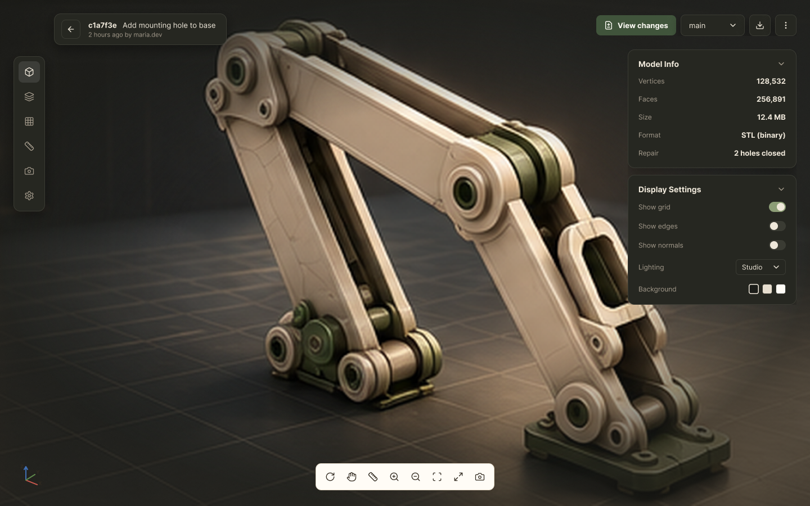

One commit in full.

- Header with the commit hash, message, author, and time, plus a branch picker, download, and a menu.
- A left tool rail (solid, layers, wireframe, measure, screenshot, settings) and a floating toolbar (orbit, pan, measure, zoom in and out, fit, fullscreen, screenshot).
- Model info: vertices, faces, size, format, and what the repair step fixed on upload.
- Actions: **View Changes** (screen 3, compared with the parent commit), **Create Branch**, **Download STL**.
- A version list for switching to nearby commits without leaving the page.
- Data: existing `GET /api/commits/:id/file`. New: mesh stats and the repair report stored with each commit.

## 3. Visual Diff

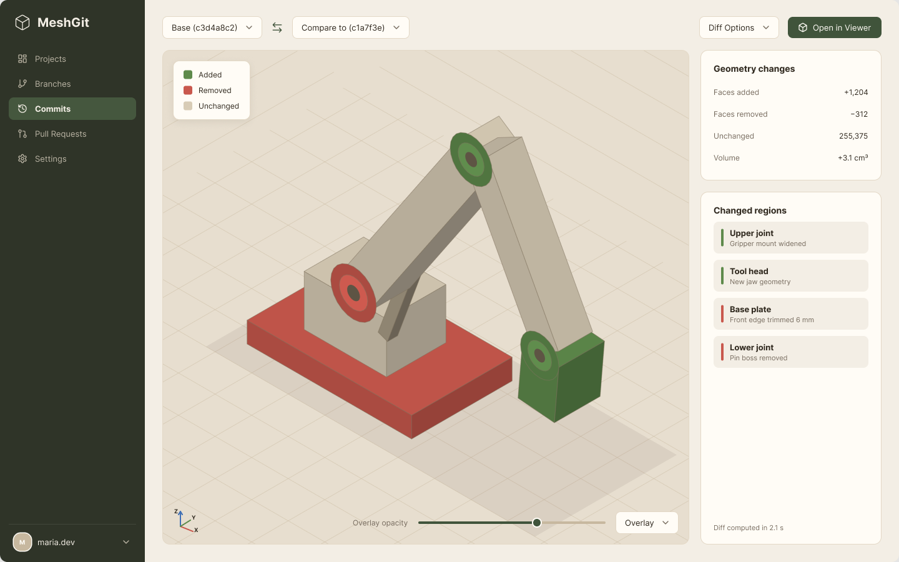

Two versions laid over each other.

- Base and compare pickers, a swap button, and diff options.
- Added geometry `#5E8A4B`, removed `#C9584D`, unchanged keeps the mesh color. The colors are fixed, not tied to the theme.
- An overlay opacity slider, and an Overlay / Side by side toggle.
- A summary of faces added, faces removed, and volume change, plus a list of changed regions. Clicking a region focuses the camera on it.
- Data: `GET /api/diff?before=&after=` (currently returns 501, to be ported from the diff work).
- Done when a diff of two 10 MB meshes renders in under 5 s, the PRD target.

## 4. Branch Graph

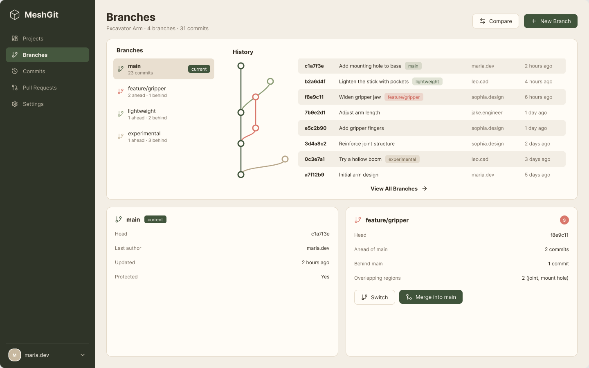

- A branch list with ahead/behind counts against `main`, with the current branch marked.
- A commit graph with one lane per branch, then the hash, message, author, and time in columns.
- Detail cards for the selected branch, with **Switch** and **Merge into main**.
- **New Branch** creates a branch from any commit.
- Data: new `GET/POST /api/branches`. Commits need a `branch_id`, and merge commits need a second parent.

## 5. Merge / Conflict View

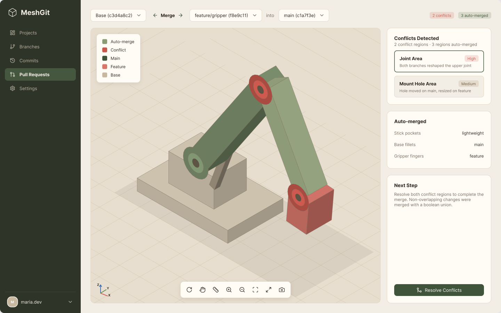

What happens when two branches are merged.

- Pickers for base, source, and target.
- Colors on the model: auto-merged, conflict, main side, feature side, and base.
- A conflict list with a severity for each region, a list of auto-merged regions, and **Resolve Conflicts**.
- Data: `POST /api/merge` (currently 501) returns the auto-merged regions and the conflict zones.
- Done when non-overlapping changes merge on their own with a boolean union, and overlap detection is more than 90% accurate, the PRD target.

## 6. Conflict Resolution

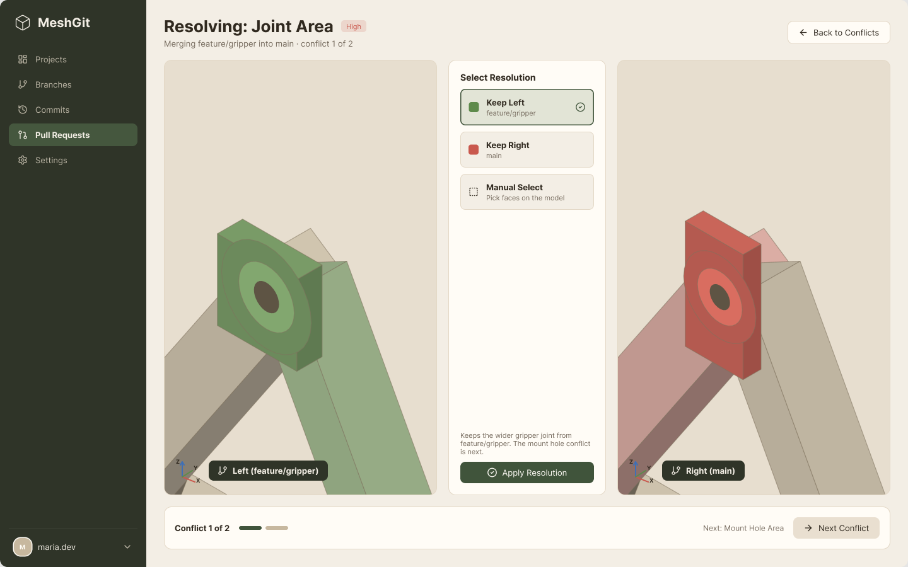

One conflict at a time, side by side.

- Close-ups of the left (source) and right (target) versions, with the cameras kept in sync.
- Choices: **Keep Left**, **Keep Right**, or **Manual Select**, which picks faces on the model.
- **Apply Resolution**, with progress through the conflicts ("1 of 2") and **Next Conflict**.
- Data: new `POST /api/merge/:id/resolutions` with the region id and the choice, or the selected face ids.

## 7. Merge Result

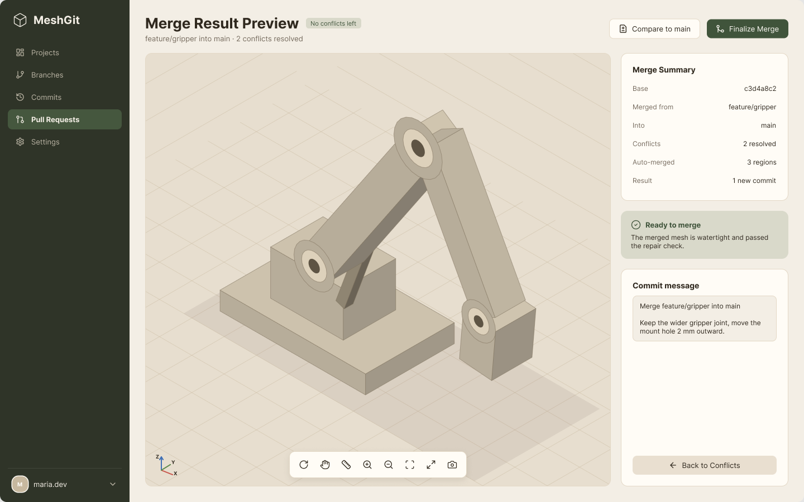

- A preview of the merged mesh before anything is committed.
- A summary: base, source, target, conflicts resolved, regions auto-merged, and the result.
- A mesh check (watertight, repair passed) before **Finalize Merge** is enabled.
- An editable commit message.
- Data: new `POST /api/merge/:id/finalize`, which creates the merge commit.

## 8. Commit History

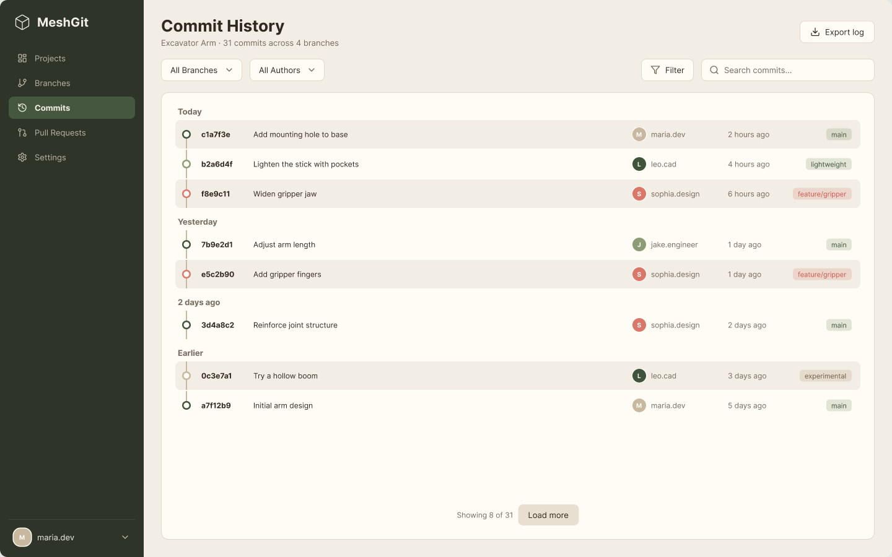

- Every commit grouped by day, with filters for branch and author and a search box.
- Each row shows the hash, message, author, time, and branch badge. Clicking a row opens it in the viewer.
- Paginated with **Load more**, not loaded all at once (the commit list currently has no pagination).
- Data: existing `GET /api/commits?project_id=`, plus new `branch`, `author`, `q`, and cursor parameters.

## 9. Landing Page

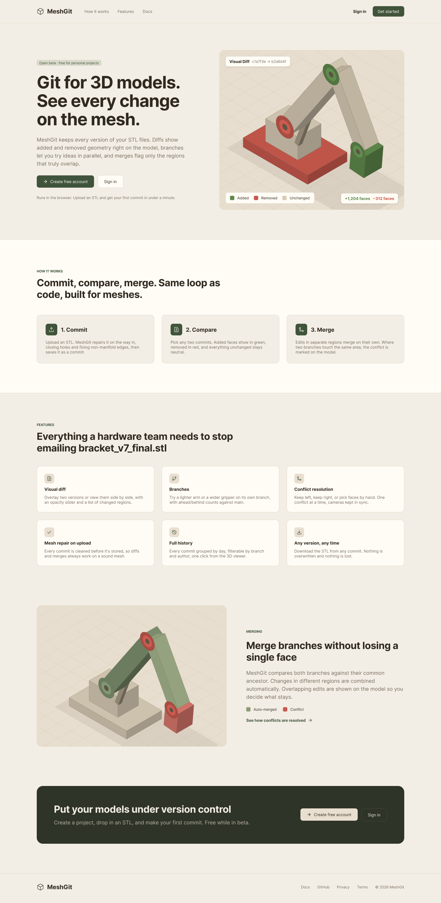

The public page people see before they sign in. It explains what MeshGit is and sends them to sign up.

- A top nav with the logo, How it works, Features, Docs, **Sign in**, and **Get started**.
- A hero with the headline, a short description, **Create free account** and **Sign in**, and a visual diff preview with the added / removed legend.
- How it works in three steps: commit (repair on upload), compare (visual diff), merge (auto-merge plus marked conflicts).
- A grid of six features: visual diff, branches, conflict resolution, mesh repair, history, and downloading any version.
- A merge section using the merge view render, a dark call-to-action band, and a footer.
- The model art comes from the diff and merge frames. The real page can use a looping render or a still image.
- Done when the page works at phone width and every button goes to sign up or sign in.

## 10. Sign In

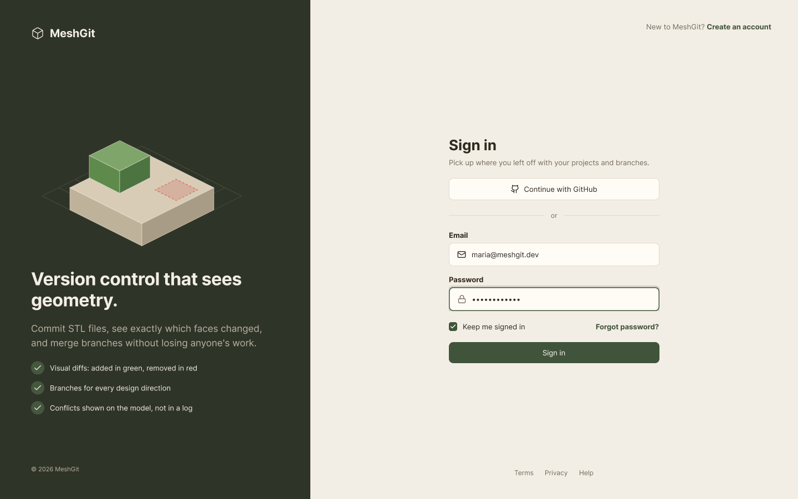

- The left half is the shared brand panel: logo, pitch, the diff illustration, and three selling points.
- **Continue with GitHub**, then email and password, **Keep me signed in**, and **Forgot password?** (screen 12).
- A **Create an account** link in the top right goes to screen 11.
- Errors show under the field they belong to, using the TextField error state.

## 11. Create Account

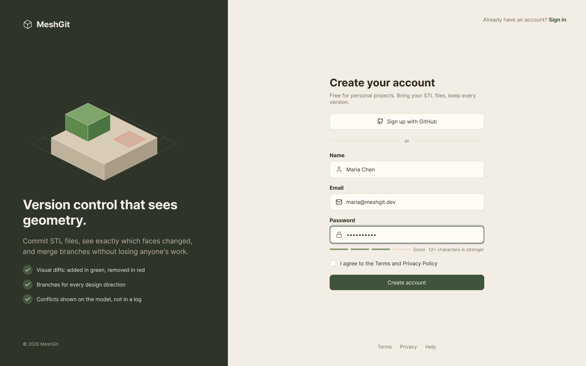

- **Sign up with GitHub**, or name, email, and password.
- A four-step strength meter under the password field.
- **Create account** stays disabled until the terms box is checked.
- After sign up, the user lands on an empty dashboard with **Upload STL** as the first action.

## 12. Reset Password

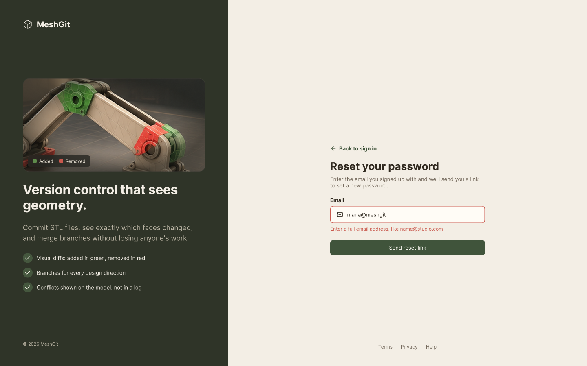

- **Back to sign in**, an email field, and **Send reset link**.
- Shown with the error state. The same message shows whether or not the email has an account, so the form can't be used to check who's signed up.

## 13. Check Your Email

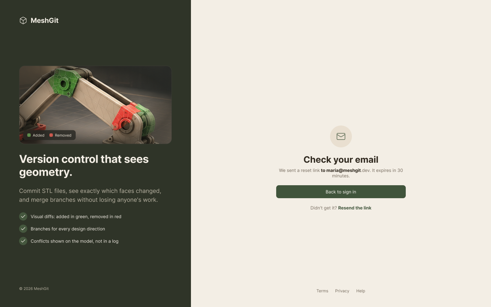

- Confirms where the link went and how long it lasts, with **Back to sign in** and a resend link.

## Shared

- The sidebar is on every app screen. Unbuilt sections stay visible but disabled. The landing page and the sign-in screens don't have it.
- The sign-in screens share the AuthBrandPanel component on the left.
- Components and tokens come from the Foundations page in Figma (see the [design README](README.md)).
- Loading states use the wireframe triangle loader (`MeshLoader`).
